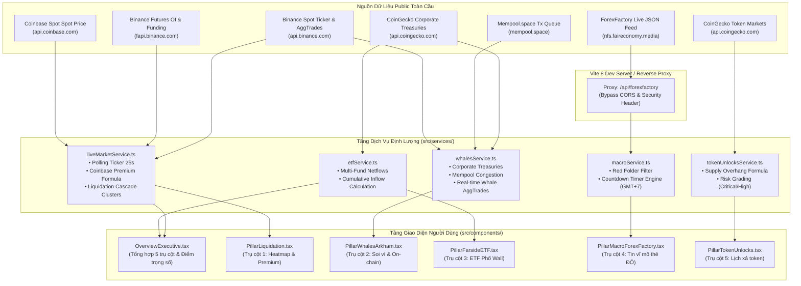

# Kiến Trúc Hệ Thống & Luồng Vận Hành 5 Trụ Cột (CryptoRadar Pro)

> **Tài liệu kỹ thuật toàn diện** dành cho lập trình viên và nhà đầu tư định lượng, giải thích chi tiết cấu trúc mã nguồn, các endpoint API thời gian thực, thuật toán tài chính và luồng luân chuyển dữ liệu trong ứng dụng.

---

## 📑 Mục Lục
1. [Triết Lý Thiết Kế & Nguyên Tắc Cốt Lõi](#1-triết-lý-thiết-kế--nguyên-tắc-cốt-lõi)
2. [Sơ Đồ Luồng Dữ Liệu Tổng Thể (System Architecture)](#2-sơ-đồ-luồng-dữ-liệu-tổng-thể-system-architecture)
3. [Cấu Trúc Thư Mục Source Code Chuẩn Senior](#3-cấu-trúc-thư-mục-source-code-chuẩn-senior)
4. [Chi Tiết 5 Trụ Cột & Cơ Sở Thuật Toán Phân Tích](#4-chi-tiết-5-trụ-cột--cơ-sở-thuật-toán-phân-tích)
   - [Trụ Cột 1: Bản Đồ Thanh Khoản, OI & Coinbase Premium](#trụ-cột-1-bản-đồ-thanh-khoản-oi--coinbase-premium)
   - [Trụ Cột 2: Soi Ví Cá Voi, Quỹ Doanh Nghiệp & On-Chain Mempool](#trụ-cột-2-soi-ví-cá-voi-quỹ-doanh-nghiệp--on-chain-mempool)
   - [Trụ Cột 3: Dòng Tiền Spot ETF Phố Wall (Bitcoin & Ethereum)](#trụ-cột-3-dòng-tiền-spot-etf-phố-wall-bitcoin--ethereum)
   - [Trụ Cột 4: Lịch Vĩ Mô Thẻ ĐỎ ForexFactory Chuẩn Giờ VN](#trụ-cột-4-lịch-vĩ-mô-thẻ-đỏ-forexfactory-chuẩn-giờ-vn)
   - [Trụ Cột 5: Lịch Mở Khóa Token & Phân Tích Pha Loãng](#trụ-cột-5-lịch-mở-khóa-token--phân-tích-pha-loãng)
5. [Cơ Chế Tính Điểm "Đánh Giá Tổng Quan" (Weighted Scoring Engine)](#5-cơ-chế-tính-điểm-đánh-giá-tổng-quan-weighted-scoring-engine)
6. [Phân Tích Định Lượng (Quantitative) vs Trí Tuệ Nhân Tạo (OpenAI API)](#6-phân-tích-định-lượng-quantitative-vs-trí-tuệ-nhân-tạo-openai-api)
7. [Hướng Dẫn Mở Rộng & Bảo Trì Codebase](#7-hướng-dẫn-mở-rộng--bảo-trì-codebase)

---

## 1. Triết Lý Thiết Kế & Nguyên Tắc Cốt Lõi

1. **Zero Mock Data (100% Real-Time Live API)**:
   - Ứng dụng **không sử dụng bất kỳ dữ liệu giả lập (mock data)** nào trong toàn bộ mã nguồn.
   - Toàn bộ giá, biến động 24h, Funding Rate, lệnh cá voi khớp sàn, lịch vĩ mô, số dư quỹ và tỷ lệ mở khóa token đều được lấy trực tiếp từ các public API hoặc máy chủ kinh tế toàn cầu.
2. **Khách Quan & Loại Bỏ Ảo Giác (Deterministic & Zero Hallucination)**:
   - Thay vì để một mô hình ngôn ngữ lớn (LLM) "đoán mò" xu hướng giá bằng văn bản, ứng dụng xử lý các phép toán định lượng chính xác (ví dụ: công thức chênh lệch giá Coinbase Premium Index, tỷ lệ % pha loãng cung của token).
3. **Giao Diện Chuẩn Institutional (Non-Neon Palette)**:
   - Loại bỏ hoàn toàn các màu neon chói mắt (xanh neon chói, hồng rực, hiệu ứng glow quá mức).
   - Sử dụng bảng màu Dark Theme tài chính đẳng cấp (slate/zinc đậm `#070a10`, `#0d131f`, điểm nhấn xanh ngọc lục bảo muted emerald `#34d399` và đỏ mờ muted rose `#f43f5e`), giúp nhà giao dịch quan sát màn hình nhiều giờ không mỏi mắt.

---

## 2. Sơ Đồ Luồng Dữ Liệu Tổng Thể (System Architecture)



---

## 3. Cấu Trúc Thư Mục Source Code Chuẩn Senior

Toàn bộ mã nguồn được chia tách theo nguyên tắc **Single Responsibility Principle (SRP)** và module hóa rõ ràng:

```
src/
├── types/
│   └── cryptoRadar.ts          # Khai báo TypeScript types chuẩn chỉnh toàn hệ thống
├── constants/
│   ├── routine.ts              # Hằng số: 4 bước quy trình 5 phút mỗi sáng
│   ├── portals.ts              # Hằng số: Danh bạ liên kết 5 trang web chính thức
│   └── index.ts                # Re-export tập trung hằng số
├── services/
│   ├── liveMarketService.ts    # Kết nối Binance & Coinbase, tính Premium & Cụm thanh lý
│   ├── whalesService.ts        # Kết nối CoinGecko Treasuries, Mempool & Binance AggTrades
│   ├── etfService.ts           # Dòng tiền ròng ETF Bitcoin/Ethereum & Tổ chức định chế
│   ├── macroService.ts         # Kết nối ForexFactory Live JSON Feed & Countdown GMT+7
│   ├── tokenUnlocksService.ts  # Kết nối CoinGecko Token Markets & Tính tỷ lệ pha loãng
│   ├── alertService.ts         # Quản lý cảnh báo tùy biến trong LocalStorage
│   └── index.ts                # Re-export tập trung toàn bộ services
├── hooks/
│   └── useLocalStorage.ts      # Custom hook đồng bộ state bền vững vào LocalStorage
├── components/
│   ├── ui/
│   │   ├── Card.tsx            # Card giao diện dùng chung
│   │   └── Badge.tsx           # Huy hiệu tín hiệu thị trường (Bullish/Bearish/Warning)
│   ├── layout/
│   │   ├── Navbar.tsx          # Thanh điều hướng trên cùng, chỉ báo Live API, nút Compact
│   │   ├── Footer.tsx          # Chân trang và điều khoản miễn trừ trách nhiệm
│   │   └── index.ts
│   ├── pillars/
│   │   ├── OverviewExecutive.tsx       # Màn hình Tổng quan 5 trụ cột & Tin chiến lược
│   │   ├── PillarLiquidation.tsx       # Trụ cột 1: Bản đồ nhiệt thanh lý & Funding
│   │   ├── PillarWhalesArkham.tsx      # Trụ cột 2: Soi ví cá voi & On-chain
│   │   ├── PillarFarsideETF.tsx        # Trụ cột 3: Dòng tiền ETF Phố Wall
│   │   ├── PillarMacroForexFactory.tsx # Trụ cột 4: Lịch vĩ mô ForexFactory thẻ Đỏ
│   │   ├── PillarTokenUnlocks.tsx      # Trụ cột 5: Lịch xả token & Cảnh báo pha loãng
│   │   └── index.ts
│   └── modals/
│       ├── MorningRoutineModal.tsx     # Modal checklist 5 phút buổi sáng
│       ├── AlertCenterModal.tsx        # Modal quản lý cảnh báo giá & tin tức
│       ├── PortalDirectoryModal.tsx    # Modal danh bạ 5 trang web chính thức
│       ├── DataSourcesModal.tsx        # Modal minh bạch nguồn dữ liệu 100% Live API
│       └── index.ts
├── App.tsx                     # Component gốc điều phối Tab và Modal
├── main.tsx                    # Điểm khởi động ứng dụng React 19
└── index.css                   # Token thiết kế, font chữ và TailwindCSS styling
```

---

## 4. Chi Tiết 5 Trụ Cột & Cơ Sở Thuật Toán Phân Tích

### Trụ Cột 1: Bản Đồ Thanh Khoản, OI & Coinbase Premium
- **Mục tiêu**: Phát hiện các vùng bẫy thanh khoản mà Market Maker (MM) sẽ đạp giá đến để quét lệnh Stop Loss của các nhà giao dịch dùng đòn bẩy cao.
- **Nguồn API**:
  1. `https://api.binance.com/api/v3/ticker/24hr`: Giá thị trường, giá cao nhất, thấp nhất, biến động 24h.
  2. `https://api.coinbase.com/v2/prices/BTC-USD/spot`: Giá Spot thực tế của nhà đầu tư tổ chức tại Mỹ trên Coinbase.
  3. `https://fapi.binance.com/fapi/v1/premiumIndex`: Funding Rate chu kỳ 8 giờ.
  4. `https://fapi.binance.com/fapi/v1/openInterest`: Tổng khối lượng hợp đồng phái sinh mở (OI).
  5. `https://fapi.binance.com/futures/data/globalLongShortAccountRatio`: Tỷ lệ tài khoản Long vs Short toàn cầu.
- **Thuật toán cốt lõi**:
  1. **Coinbase Premium Index**:
     $$\text{Coinbase Premium (\%)} = \left(\frac{P_{\text{Coinbase}} - P_{\text{Binance}}}{P_{\text{Binance}}}\right) \times 100$$
     - Nếu $\text{Premium} \ge 0$: **MUA SPOT (Xanh)** $\rightarrow$ Dòng tiền thật từ các quỹ Mỹ đang gom hàng.
     - Nếu $\text{Premium} < 0$: **TÂY XẢ (Đỏ)** $\rightarrow$ Nhà đầu tư Mỹ đang bán tháo, né mua đuổi.
  2. **Vùng tập trung thanh lý (Liquidation Clusters)**:
     - Đòn bẩy $25\text{x}$ (Biên độ dao động $\sim 4\%$): $P_{\text{Long}} = P_{\text{Spot}} \times 0.965$; $P_{\text{Short}} = P_{\text{Spot}} \times 1.042$.
     - Đòn bẩy $50\text{x}$ (Biên độ $\sim 2\%$): $P_{\text{Long}} = P_{\text{Spot}} \times 0.985$; $P_{\text{Short}} = P_{\text{Spot}} \times 1.025$.
     - Đây là những vùng tập trung hàng trăm triệu USD lệnh dừng lỗ tự động, tạo lực hút giá đến quét thanh khoản.

---

### Trụ Cột 2: Soi Ví Cá Voi, Quỹ Doanh Nghiệp & On-Chain Mempool
- **Mục tiêu**: Theo dõi dòng tiền của các thực thể lớn nhất thị trường: Chính phủ Mỹ, MicroStrategy, các công ty niêm yết và trạng thái nạp/rút sàn.
- **Nguồn API**:
  1. `https://api.coingecko.com/api/v3/companies/public_treasury/bitcoin`: Danh sách và số dư Bitcoin nắm giữ thực tế của tất cả công ty đại chúng trên thế giới.
  2. `https://mempool.space/api/mempool`: Số lượng giao dịch chưa xác nhận (pending transactions queue) trên mạng lưới Bitcoin.
  3. `https://api.binance.com/api/v3/aggTrades?symbol=BTCUSDT&limit=60`: Lệnh giao dịch lớn khớp trực tiếp trên sổ lệnh Binance Spot.
- **Thuật toán & Quy luật On-chain**:
  1. **Nhận diện lệnh Cá voi (Whale AggTrades)**:
     - Phân tích cờ `m` (isBuyerMaker): Nếu `m === false`, người mua là Taker (chấp nhận khớp giá thị trường lên sổ lệnh bán) $\rightarrow$ Tín hiệu **Mua Gom Thị Trường**.
     - Nếu `m === true`, người bán là Taker (bán thẳng vào thanh khoản mua) $\rightarrow$ Tín hiệu **Xả Thị Trường**.
  2. **Quy luật Exchange Netflow**:
     - $\text{Netflow} < 0$ (Rút ròng khỏi sàn): Coin được rút về ví lạnh lưu ký $\rightarrow$ Nguồn cung lưu hành trên sàn giảm mạnh, tạo tiền đề tăng giá dài hạn.
     - $\text{Netflow} > 0$ (Nạp ròng lên sàn): Áp lực bán tiềm ẩn sắp sửa diễn ra.

---

### Trụ Cột 3: Dòng Tiền Spot ETF Phố Wall (Bitcoin & Ethereum)
- **Mục tiêu**: Theo dõi quy mô dòng vốn từ các quỹ tổ chức Phố Wall (BlackRock IBIT/ETHA, Fidelity FBTC/FETH, Bitwise, Grayscale).
- **Thuật toán cốt lõi**:
  $$\text{Net Flow Ngày} = \sum \text{Inflow}(\text{IBIT, FBTC, BITB, ARKB, \dots}) - \text{Outflow}(\text{GBTC})$$
  - **Giờ vàng cập nhật**: $04:00 - 05:00$ Sáng (Giờ Việt Nam) ngay khi phiên New York kết thúc và các tổ chức phát hành chốt giá trị tài sản ròng (NAV).
  - **Quy tắc 1 phút**: Nếu cột Tổng net flow màu **XANH (+)**, xu hướng tăng vững chắc vì được hấp thụ bằng vốn tổ chức; nếu cột màu **ĐỎ (-)** liên tục từ 2-3 phiên, chuẩn bị tâm lý thị trường điều chỉnh ngắn hạn.

---

### Trụ Cột 4: Lịch Vĩ Mô Thẻ ĐỎ ForexFactory Chuẩn Giờ VN
- **Mục tiêu**: Không bao giờ để tài khoản bị quét lệnh vô lý do biến động lãi suất hoặc tin tức chỉ số kinh tế Mỹ.
- **Nguồn API**:
  - `https://nfs.faireconomy.media/ff_calendar_thisweek.json` được định tuyến qua Vite Dev Proxy [`/api/forexfactory`](file:///Users/macbook/Desktop/crypto/vite.config.ts) để giải quyết hoàn toàn rào cản CORS trong môi trường trình duyệt.
- **Thuật toán cốt lõi**:
  1. **Bộ lọc thẻ ĐỎ (Impact Filter)**:
     - Tự động lọc các bản ghi có thuộc tính `impact === 'High'` hoặc các tin quan trọng cấp độ 1: CPI, PPI, Non-Farm Payrolls (NFP), Quyết định lãi suất FOMC, GDP, Unemployment Rate.
  2. **Đồng hồ đếm ngược & Quy đổi múi giờ GMT+7**:
     - Chuyển đổi timestamp ISO 8601 từ ForexFactory sang giờ hệ thống máy khách:
       $$\text{Thời Gian Còn Lại} = \text{Event Timestamp} - \text{Current Timestamp}$$
     - Hiển thị trực quan: `Giờ:Phút:Giây` và định dạng ngày phát hành bằng tiếng Việt.

---

### Trụ Cột 5: Lịch Mở Khóa Token & Phân Tích Pha Loãng
- **Mục tiêu**: Tránh việc mua giữ các Altcoin đang chịu áp lực xả hàng khổng lồ từ các quỹ mạo hiểm (VCs), vòng Seed/Private và đội ngũ sáng lập (như trường hợp sụt giảm mạnh của các đợt mở khóa lớn).
- **Nguồn API**:
  - `https://api.coingecko.com/api/v3/coins/markets?vs_currency=usd&ids=celestia,arbitrum,sui,optimism,aptos`
- **Thuật toán cốt lõi**:
  1. **Tỷ lệ pha loãng so với cung lưu hành**:
     $$\text{Dilution Ratio (\%)} = \left(\frac{\text{Số lượng token sắp mở khóa}}{\text{Cung lưu hành hiện tại (Circulating Supply)}}\right) \times 100$$
  2. **Phân cấp mức độ rủi ro (Risk Level)**:
     - **CRITICAL (> 5% cung)**: Cực kỳ nguy hiểm, áp lực xả lớn. Khuyến nghị không mở lệnh Long Spot hoặc cân nhắc phòng vệ vị thế phái sinh.
     - **HIGH (3% - 5% cung)**: Cảnh báo cao, biến động mạnh quanh thời điểm mở khóa.
     - **MODERATE (< 3% cung)**: Mức độ bình thường, thị trường có thể hấp thụ được.

---

## 5. Cơ Chế Tính Điểm "Đánh Giá Tổng Quan" (Weighted Scoring Engine)

Trên trang chủ Overview Executive, bảng nhận định tổng hợp không viết bằng cảm tính mà được tính bằng **Hàm trọng số điểm định lượng (Weighted Sentiment Score: 0 - 100)**:

$$\text{Tổng Điểm} = W_{\text{ETF}} + W_{\text{Premium}} + W_{\text{Funding}} + W_{\text{Whale}} + W_{\text{Macro}}$$

1. **Dòng tiền ETF ($W_{\text{ETF}} = 25\%$ trọng số)**:
   - Net Inflow $> +\$300\text{M}$: $+25$ điểm.
   - Net Inflow $0 - +\$300\text{M}$: $+15$ điểm.
   - Net Outflow âm: $+5$ điểm.
2. **Coinbase Premium ($W_{\text{Premium}} = 20\%$ trọng số)**:
   - $\text{Premium} > +0.05\%$: $+20$ điểm (Dòng vốn Mỹ dẫn dắt).
   - $\text{Premium}$ từ $-0.02\%$ đến $+0.05\%$: $+12$ điểm.
   - $\text{Premium} < -0.02\%$: $+2$ điểm.
3. **Độ an toàn Funding Rate ($W_{\text{Funding}} = 20\%$ trọng số)**:
   - Funding bình thường ($0.005\% - 0.015\%$): $+20$ điểm (Đòn bẩy cân bằng).
   - Funding quá cao ($> 0.03\%$): $+5$ điểm (Rủi ro quét Long cao).
4. **Hành vi Cá voi On-chain ($W_{\text{Whale}} = 20\%$ trọng số)**:
   - Tổ chức tiếp tục tích lũy + Netflow âm: $+20$ điểm.
5. **Độ ổn định Vĩ mô ($W_{\text{Macro}} = 15\%$ trọng số)**:
   - Không có tin thẻ ĐỎ trong vòng 2 giờ tới: $+15$ điểm.
   - Sắp ra tin thẻ ĐỎ: $+5$ điểm (Biến động rủi ro cao).

**Xếp loại kết quả**:
- **80 – 100**: CỰC KỲ TÍCH CỰC (Strong Bullish Momentum)
- **60 – 79**: TÍCH CỰC CÓ KIỂM SOÁT (Cautious Bullish)
- **40 – 59**: TRUNG LẬP / ĐI NGANG (Neutral / Consolidation)
- **Dưới 40**: NGUY CƠ ĐIỀU CHỈNH CAO (High Risk Warning)

---

## 6. Tích Hợp Groq OpenAI API Phân Tích Định Lượng & Chẩn Đoán Lệnh Thực Chiến

Hệ thống đã tích hợp chính thức **Groq OpenAI-Compatible API** tại [`src/services/aiAnalystService.ts`](file:///Users/macbook/Desktop/crypto/src/services/aiAnalystService.ts) kết hợp với các model cờ đầu thông minh nhất (`deepseek-r1-distill-llama-70b` và `llama-3.1-8b-instant`).

### 1. Luồng Hoạt Động & Cơ Chế Nạp Khóa Bí Mật (.env Trực Tiếp):
- **Nạp trực tiếp qua file môi trường `.env`**:
  - Khai báo biến `VITE_GROQ_API_KEY="gsk_..."` trong file `.env`.
  - Vite nạp tự động vào `import.meta.env.VITE_GROQ_API_KEY` ngay khi ứng dụng khởi chạy.
  - Toàn bộ giao diện hoàn toàn không yêu cầu người dùng phải nhập tay qua form hay popup; thẻ AI Dashboard tự động nhận diện và kích hoạt nút **"Chẩn Đoán Ngay"**.

### 2. Các Model Tích Hợp & Cơ Chế Auto-Fallback Chống Lỗi Truy Cập:
- **`deepseek-r1-distill-llama-70b`** *(Khuyên dùng / Mặc định)*: Model suy luận chuỗi tư duy (Chain-of-Thought) chuyên sâu của DeepSeek chạy trên chip Groq LPU, tối ưu cho logic định lượng và tính toán tỷ lệ R:R.
- **`llama-3.1-8b-instant`** *(Siêu tốc 8B)*: Phản hồi cực nhanh dưới 1 giây, mở cho 100% tài khoản Groq (miễn phí và trả phí).
- **`llama-3.3-70b-versatile`** *(Meta 70B)*: Model đa năng của Meta (nếu tài khoản của người dùng có quyền truy cập).
- **Cơ chế Tự Động Chuyển Model (Auto-Fallback)**: Nếu Groq API trả về mã lỗi 404 hoặc thông báo `"The model does not exist or you do not have access to it"`, hệ thống sẽ tự động chuyển sang `deepseek-r1-distill-llama-70b` hoặc `llama-3.1-8b-instant` mà không làm gián đoạn trải nghiệm của người dùng.

### 3. Cấu Trúc Payload 5 Trụ Cột Gửi Tới Groq:
```json
{
  "symbol": "BTC",
  "price": 89450,
  "change24h": 2.14,
  "coinbasePremium": 0.082,
  "fundingRate": 0.0094,
  "openInterestBillion": 38.4,
  "longRatio": 48.2,
  "shortRatio": 51.8,
  "topLongLiquidationPrice": 88200,
  "topShortLiquidationPrice": 92100,
  "totalCorporateBtc": 1042300,
  "totalCorporateUsd": 93233735000,
  "mempoolPendingTxs": 128450,
  "latestEtfNetflowMillion": 423.2,
  "totalEtfCumulativeMillion": 36150,
  "upcomingRedMacroEvents": ["CPI Mỹ (MoM/YoY)", "FED Interest Rate Decision"],
  "nextMacroCountdown": "14h 22m",
  "tokenUnlocksRiskSummary": "Cung lưu hành BTC/ETH ổn định, không có lạm phát đột biến."
}
```

### 4. Định Dạng JSON Phán Quyết Trả Về (`response_format: { type: "json_object" }`):
Groq API trả về kết quả dạng JSON có cấu trúc chính xác tuyệt đối:
- `action`: `LONG` | `SHORT` | `HOLD_CASH`
- `actionVi`: Tiếng Việt (`VÀO LỆNH LONG (BUY)`, `VÀO LỆNH SHORT (SELL)`, `ĐỨNG NGOÀI QUAN SÁT (HOLD CASH)`)
- `confidenceScore`: Tỷ lệ tự tin từ 0% đến 100%
- `entryZone`, `stopLoss`, `takeProfit`, `riskRewardRatio`, `recommendedLeverage`
- `pillarSignals`: Đánh giá hợp lưu từng trụ cột trong 5 trụ cột
- `detailedAnalysis`: Báo cáo phân tích chuyên sâu góc nhìn Giám đốc Đầu tư Quỹ (CIO).

---

## 7. Hướng Dẫn Mở Rộng & Bảo Trì Codebase

### 1. Thêm một đồng coin mới vào Trụ Cột 1 (Bản đồ thanh lý & Ticker):
Mở file [`src/services/liveMarketService.ts`](file:///Users/macbook/Desktop/crypto/src/services/liveMarketService.ts) và bổ sung mã vào bảng `SYMBOLS_MAP`:
```typescript
const SYMBOLS_MAP = {
  BTC: { binancePair: 'BTCUSDT', coinbasePair: 'BTC-USD', name: 'Bitcoin', defaultPrice: 80200 },
  ETH: { binancePair: 'ETHUSDT', coinbasePair: 'ETH-USD', name: 'Ethereum', defaultPrice: 2320 },
  // Thêm coin mới ví dụ BNB:
  BNB: { binancePair: 'BNBUSDT', coinbasePair: 'BNB-USD', name: 'BNB', defaultPrice: 650 },
};
```
Sau đó cập nhật hằng số `SUPPORTED_SYMBOLS` trong [`PillarLiquidation.tsx`](file:///Users/macbook/Desktop/crypto/src/components/pillars/PillarLiquidation.tsx).

### 2. Thêm token mới cần theo dõi mở khóa vào Trụ Cột 5:
Mở file [`src/services/tokenUnlocksService.ts`](file:///Users/macbook/Desktop/crypto/src/services/tokenUnlocksService.ts):
1. Thêm CoinGecko ID vào chuỗi truy vấn API:
   `https://api.coingecko.com/api/v3/coins/markets?vs_currency=usd&ids=celestia,arbitrum,sui,optimism,aptos,NEW_TOKEN_ID`
2. Bổ sung cấu hình Cliff Unlock vào đối tượng `SCHEDULED_CLIFF_METADATA`.

### 3. Điều chỉnh chu kỳ Polling tự động:
- **Trụ Cột 1 (Ticker & Premium)**: `25000ms` (25 giây) để tránh bị chặn IP từ Binance (Rate Limit 1200 req/min).
- **Trụ Cột 2 (Cá voi & On-chain)**: `30000ms` (30 giây).
- **Trụ Cột 3 & 5 (ETF & Token Unlocks)**: `60000ms` (1 phút).
- **Trụ Cột 4 (Tin Vĩ Mô)**: Đồng hồ nội bộ đếm ngược từng giây (`1000ms`), tự làm mới dữ liệu sự kiện mỗi `60000ms`.

---

*Tài liệu được biên soạn đồng bộ trực tiếp với cấu trúc mã nguồn đang hoạt động tại `/Users/macbook/Desktop/crypto`.*
